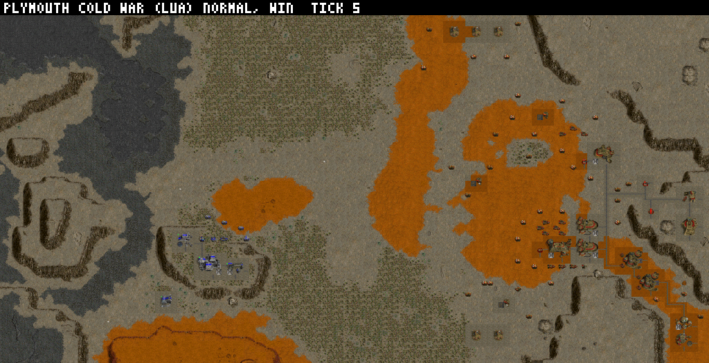
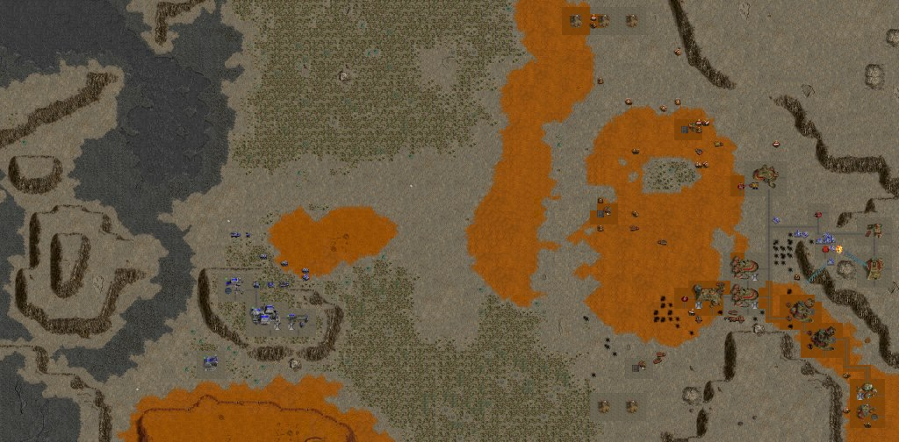
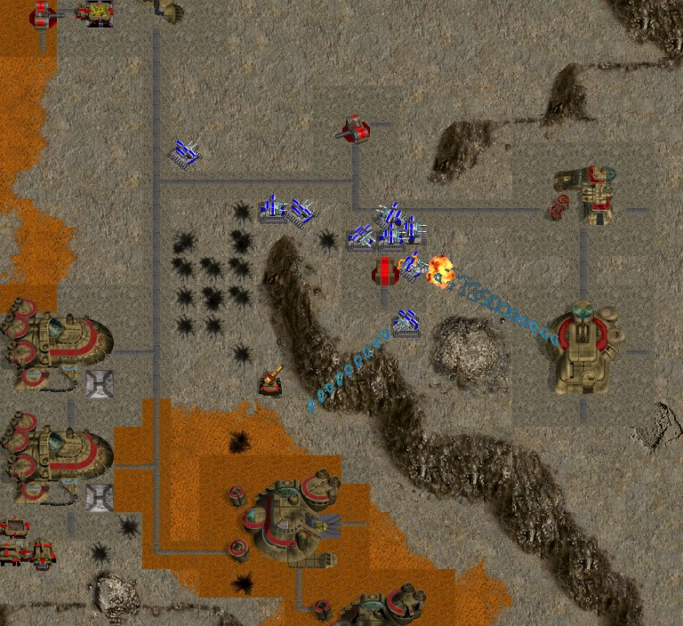

# From a running game to pictures and timelapses



<sub>Plymouth Cold War (Lua), Normal: 24 Tiger Rail Guns take the Plymouth Advanced Lab, victory at tick 6392. Played
by OP2TestHarness, joined by OP2Timelapse, one frame every 500 ticks.</sub>

Three tools, one chain:

```
OP2TestHarness            OP2Imager                     OP2Timelapse
plays the mission    ->   draws any saved moment    ->  joins the frames
in the real game,         from its state file,          into an animated
writes a state file       with no game running          GIF
every N ticks
```

- **OP2TestHarness** runs the real Outpost 2 (its own private copy of the game, not your install) with a module
  loaded into it. It picks the mission, runs it as fast as it can, applies a script (give ore, spawn units, give
  orders), records what happens, and every N ticks writes the whole map as the game draws it (`map_<tick>.png`) and
  the moment it shows (`state_<tick>.json`). Only the game can *play* a mission: the AI, the fights, the disasters.
- **OP2Imager** draws a map, a mission's start, a saved game, or a harness **state file**: one moment, without the
  game running. From a state it draws exactly what the game drew, byte for byte, at any power-of-two scale.
- **OP2Timelapse** joins a folder of frames into a GIF, with a label bar on each frame.

So the game is needed once, to play. Everything after that (drawing at another size, drawing again later, joining
the frames) works from the state files alone.

## 1. Play the mission in the harness

The harness lives in OP2TestHarness (its README is the reference for every option). It plays in its own copy of the
game (`OP2TestHarness/game`, made by `python -I windows/run_win.py setup`). Put the mission's files in a folder under
that copy's `OPU/maps`, as you would in a real install.

On Windows the module reads `OP2H_*` settings; `run_win.launch` starts the game with them and waits. A runner for one
mission, with the map images on:

```python
import json, sys
from pathlib import Path
sys.path.insert(0, r"<OP2TestHarness>\windows")
import run_win
run_win.use_game(run_win.DEFAULT_GAME)
out = Path(sys.argv[1]); out.mkdir(parents=True, exist_ok=True)
env = dict(OP2H_MISSION=sys.argv[2],         # the mission DLL's file name
           OP2H_OUT=str(out),
           OP2H_TICKS=sys.argv[3],           # stop at this tick (or when the mission ends)
           OP2H_SEED="1",                    # same seed + same script = the same game, every time
           OP2H_DIFFICULTY=sys.argv[4],      # 0 Easy, 1 Normal, 2 Hard
           OP2H_SCRIPT=sys.argv[5] if len(sys.argv) > 5 else "",
           OP2H_MAP_EVERY="500",             # a map image + state file at tick 5, every 500 ticks, and at the end
           OP2H_MAP_PX="8",                  # pixels a tile: 1, 2, 4, 8, 16 or 32 (the game's own size)
           OP2H_TRACE_EVERY="100", OP2H_TELEM_EVERY="100", OP2H_STATE="1", OP2H_AUDIO="1",
           OP2H_SHOT_EVERY="0", OP2H_TURBO="1", OP2H_SPEED="10", OP2H_WIDTH="1024", OP2H_HEIGHT="768")
print(json.dumps({k: run_win.launch(env, out, timeout=1800).get(k) for k in ("exit_code", "timed_out", "quit", "ok")}))
```

```
python -I run_map.py OUT\win cPlymouthColdWarLua.dll 40000 1 win.txt
```

On Linux, `run.sh --mission NAME --map-every N --map-px N --script FILE ...` does the same.

What lands in `OUT` (the ones this chain uses):

| File | What |
|---|---|
| `map_<tick>.png` | the whole map, drawn by the game itself, in full daylight, without health bars or selection marks |
| `state_<tick>.json` | the moment that image shows: tiles, every unit, and what the game drew (below) |
| `events.jsonl`, `state.json` | units made, hit and destroyed, objectives met, the end and its reason; the state at the end |
| `trace.jsonl`, `telemetry.jsonl` | every unit and every player every N ticks, for comparing two runs |
| `harness.log` | what the module did, each script line, and why the run stopped |



<sub>`map_0006000.png` of the win run, 8 px a tile: Eden's base on the left, the Tigers at the Plymouth base on the
right. Drawn by the game, in full daylight, without health bars.</sub>

Map images don't change the game: the harness puts the view back after drawing, and a run's telemetry is the same
with and without them. They do slow it: Plymouth Cold War ran at ~185 ticks a second with an image every 100 ticks,
~3,500 with one every 2,000.

## 2. Steer the game with a script

With nobody playing, the human colony just sits there. A harness script (`OP2H_SCRIPT`, one `<tick> <verb> <args>`
per line) plays the part of the player. Plymouth Cold War's win test (`win.txt`, shortened):

```
0   coords file                                # x/y below are file tiles (the status bar's, less one)
10  spawn  BIG_TANK 0 40 49 RAIL_GUN 0         # type, owner, x, y, weapon, rotation: a Tiger Rail Gun, @0
10  spawn  BIG_TANK 0 40 50 RAIL_GUN 0         # @1, and so on to @23
100 player 0 common 9000                       # 9000 Common Ore: the mining objective is met
200 attack @0 $TOWER_GUARD@97,42               # @0 attacks the Guard Post nearest file tile (97,42)
5000 attack @0 $LAB_ADV@124,38                 # then the Advanced Lab
```

- `@N` is the unit the Nth `spawn` made; `$TYPE@x,y` is the live unit of that type nearest a tile (within 3);
  `name` and `as` bind names to units the game makes.
- Orders go to the game as the UI sends them (`move`, `dock`, `guard`, `patrol`, ...), except `attack`, which is
  `Unit::DoAttack` and sends nothing when the target is already destroyed: repeat it for the next target.
- There are verbs for economy (`player`, `produce`, `build`, `tech`), disasters, AI groups, mouse and keys, and
  saved games: see the harness README.

A unit told to attack a structure heads for it and doesn't stop for what shoots it on the way. The first win test,
16 Tigers sent straight at the Lab, jammed in the Plymouth base and was destroyed; 24 taking the guard posts and
factories first, then the Lab, won at tick 6392.

## 3. What a state file holds

`state_<tick>.json` is the moment one map image shows, as JSON (about 70 KB for a 128x64 map). From Plymouth Cold
War at tick 100,000:

```
tick 100000   mark 1000   mission cPlymouthColdWarLua.dll   map eden03.map   width 128  height 64
px 8   shown [1024, 504]   daylight 0   animCounter 100000
players  [{"id": 0, "colour": 0, "eden": 1, "human": 1}, ...]
tiles    8192 numbers: each tile's graphic now (dozed ground, tubes, walls, rubble), row by row
cells    8192 numbers: each tile's cell type
objects  every unit, structure and beacon:
  {"i": 9,  "type": "COMMAND",  "owner": 0, "x": 1072, "y": 1312, "rot": 0, "damage": 0,   "flags": 64517, ...}
  {"i": 92, "type": "BIG_TANK", "owner": 0, "x": 1328, "y": 1552, "rot": 0, "damage": 306, "cargo": 63, ...}
views    what the game drew, piece by piece: each sprite, laser and microwave beam, in the game's order
```

`x` and `y` are pixels (32 to a tile), `rot` the way it faces (0-255), `damage` what it has taken, `cargo` a
vehicle's weapon or a truck's load. Divide by 32 for the file tile a script's `$TYPE@x,y` wants: the Lab at pixel
(3984, 1232) is file tile (124, 38). The harness README lists every field.

## 4. Draw a state with OP2Imager

```
OP2Imager -s 16 --game-dir <OP2TestHarness>\game -d frames OUT\win
```

draws every `state_*.json` in the folder (or name one file) as `frames\state_<tick>.png`. No game runs:
`--game-dir` is only where the map, the tilesets and the unit art are read from. `-s` picks the pixels a tile; at a
power of two (1 to 32) the picture is the one the game would draw at that size.



<sub>The same moment as the picture above, drawn by OP2Imager from `state_0006000.json` alone at 32 px a tile (the
game's own size, four times the harness run's), with no game running: Tigers firing their rail guns at the Advanced
Lab (right), the Vehicle Factories (left), the craters of the fight.</sub>

Measured on Plymouth Cold War (2026-11-21):

| Check | Result |
|---|---|
| 90 state files of a 177,848-tick game, drawn at 8 px a tile | all 90 **byte-identical** to the game's `map_<tick>.png`, in 13 seconds |
| one state at tick 6000, drawn at 16 px a tile (2048x1008), against the same game run again with `OP2H_MAP_PX=16` | **byte-identical** (`OP2Imager --compare`: `identical`) |

So a run at 8 px is enough: draw it again at 16 or 32 later, from the states, without playing the game again.
`OP2Imager --compare A B` checks any two images' pixels.

## 5. Join the frames with OP2Timelapse

```
OP2Timelapse --title "PLYMOUTH COLD WAR (LUA) NORMAL, WIN" --delay 30 --last 300 win.gif OUT\win
```

takes a folder's `map_<tick>.png` in tick order and labels each frame `TITLE  TICK <tick>`. `--delay` is each
frame's time in hundredths of a second (default 40), `--last` the last frame's before the loop (default four times
the delay), `--no-label` drops the bar. For OP2Imager's `state_<tick>.png`, rename them `map_<tick>.png` first, so the
frames are labelled with their tick.

The frames share one palette of 253 colours, and each frame after the first stores only what changed: 81 frames of
1024x526 make a 680 KB GIF. Aim for about 100 frames: an image every 100 ticks for a game of 8,000, every 2,000 for
one of 200,000.

## 6. Compare two missions tick for tick

Two runs with the same seed and the same script play the same game. That makes the harness a checker for a port:
run the original and the port, then

```
python -I <OP2TestHarness>\windows\trace_diff.py OUT\orig\trace.jsonl OUT\lua\trace.jsonl
```

prints `MATCH` or the first tick and field that differ; `events.jsonl`, `telemetry.jsonl` and `state.json` can be
compared byte for byte, and so can the map images. Plymouth Cold War's Lua port was checked this way against the C++
DLL, through the loss, the reinforcements, 100,000 ticks of disasters and the win: identical in every one.

## Examples: Plymouth Cold War

The timelapses made for Plymouth Cold War, all of the Lua port on Normal, seed 1 (the last is the one at the top):

| GIF | Script | Ticks | Image every | Frames | What you see |
|---|---|---|---|---|---|
| `pcw-normal.gif` | Common Ore at tick 4000 | to the loss at 7,956 | 100 | 81 | the reinforcements drive in; Plymouth wears the colony down |
| `pcw-tigers.gif` | 12 Tigers at tick 10 | 100,000 | 1,000 | 101 | the colony holds; disasters come and go |
| `pcw-8-tigers.gif` | 8 Tigers at tick 10 | to the loss at 177,848 | 2,000 | 90 | the Tigers fall one by one, then the colony |
| `pcw-win.gif` | `win.txt`: Common Ore and 24 Tigers | to the win at 6,392 | 500 | 14 | the strike force takes the Advanced Lab |

## Limits

- The game has to play the mission once: OP2Imager draws moments, it doesn't run the game on from them.
- Map images are in full daylight unless `OP2H_MAP_DAYLIGHT=0` (`--map-night`).
- A state written by an older harness, without `views`, is drawn from its objects instead: close, not exact (units
  whole, facing kept to eight directions).
